# 开源剪切板历史工具 《clip》怎么使用，详细图解

Clip 是一个驻留在系统托盘的剪贴板历史管理工具，自动记录你复制过的文本和图片，支持分组管理、快速搜索、颜色格式转换、百度/有道翻译和局域网实时共享，完全免费开源（GPL-3.0）。

支持 macOS、Windows、Linux 三大平台。

## 设计理念

剪贴板历史工具不需要太多花哨的功能：在后台默默记录，需要时快速复制回来，这样就够了。

"快速呼出"是这类工具的核心问题。常见方案是设置快捷键，但我电脑上的快捷键已经够多了，不想再记新的。

速度也不能牺牲。权衡之后，我选择**托盘直接呼出**：不用记忆任何快捷键，点击托盘图标，历史记录就在眼前。

## 下载、安装

### 下载

**系统要求**：macOS 10.13+ / Windows 10+ / Linux（X11/Wayland）

打开 [GitHub Releases](https://github.com/DoYoungDo/clip/releases/latest)，根据你的系统选择对应压缩包：

| 系统 | 说明 |
|:--|:--|
| macOS Apple Silicon | `*-darwin-arm64.zip` |
| macOS Intel | `*-darwin-amd64.zip` |
| Linux | `*-linux-amd64.tar.gz` |
| Windows | `*-windows-amd64.zip` |

### 安装

解压后即可得到可执行文件，无需安装过程：

- **macOS**：将 `clip` 拖入「应用程序」或任意目录后双击运行。
  由于应用未签名，首次打开可能被拦截，请参考 [mac 安装未知应用常见问题](https://doyoungdo.github.io/essay/#/Other/mac_install_unknown_app) 解除限制。
- **Windows**：解压后双击 `clip.exe` 运行。
- **Linux**：解压后赋予执行权限后运行：`chmod +x clip && ./clip`

程序启动后**没有任何窗口**，请留意屏幕角落的系统托盘区出现 Clip 图标，即为启动成功：

**图：macOS 系统托盘图标**


**图：Windows 系统托盘图标**

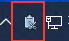

之后的所有操作都围绕托盘图标展开。

## 使用

### 两个入口：左键与右键

- **左键**点击托盘图标：快捷菜单，历史、分组、搜索都在，点击条目即复制，这是最常用的操作。
- **右键**点击托盘图标：完整菜单，在左键的基础上叠加所有管理功能。

| 功能 | 左键 | 右键 |
|:--|:--|:--|
| 历史条目 | 点击直接复制 | 悬停出现二级菜单（复制/颜色转换/重命名/删除） |
| 分组 | 查看、复制分组条目 | 增加 激活/重命名/删除分组 |
| 🔎 搜索 | ✓ | ✓ |
| 清空历史 / ➕ 创建分组 | ✗ | ✓ |
| 配置 / 关于 / 退出 | ✗ | ✓ |

**图：左键快捷菜单**

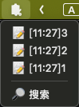

**图：右键完整菜单**

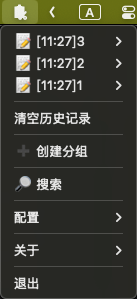

> 程序没有窗口，右键菜单底部的「退出」是唯一的退出入口；退出时会自动保存配置和历史记录。旁边的「关于」可查看版本号、协议、作者主页与源码仓库。

**图：关于与退出入口**

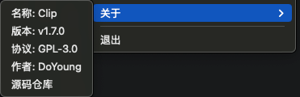

### 看懂历史记录条目

历史记录按时间倒序排列（最新在最上方），每条记录的格式为：

```text
📝 [15:04] 复制的文本内容
🖼️ [15:04] 图片 [a1b2c3d4]
📝 [15:04] [R] 来自局域网共享的内容
```

- `📝` / `🖼️`：区分文本和图片
- `[15:04]`：记录时间（默认 `hh:mm`，可自定义）
- `[R]`：该内容来自局域网共享，而非本机复制
- 文本超过 40 字符会截断显示为 `...`；左键菜单中鼠标悬停可查看完整内容，右键开启扩展功能后悬停提示由二级菜单取代
- 图片默认显示为 `图片 [哈希前8位]`，重命名后显示名称

### 关键机制：最新一条是所有"输入"的来源

历史记录最上面那条（最新复制的）是一条特殊记录：**所有需要内容作为输入的功能，读取的都是它**。因此 Clip 的操作习惯永远是"先复制，再点菜单"：

- ➕ 创建分组：以最新一条作为分组名
- 分组「重命名」、图片「重命名」：以最新一条作为新名称
- 翻译器启用：以最新一条作为密钥（如 "appkey 密钥"）
- 局域网共享「连接到」：以最新一条作为服务地址
- 「设置最大历史记录条数」：以最新一条作为数字
- 「设置搜索高亮标记」：以最新一条作为标记
- 「设置时间格式」：以最新一条作为格式
- 🔎 搜索：以最新一条作为关键词

注意：这些功能要求最新一条必须是**文本**。如果最新记录是图片，操作会无效，先复制一段文本再操作即可。

*示例：*`创建分组`

**图：复制文本后，它成为历史最新一条（右键菜单）**

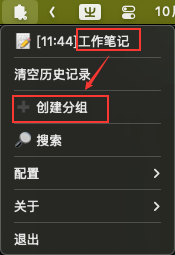

**图：点击 ➕ 创建分组后，左键菜单出现同名分组**

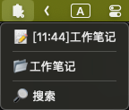

**图：右键菜单中的新分组，悬停可激活/重命名/删除**

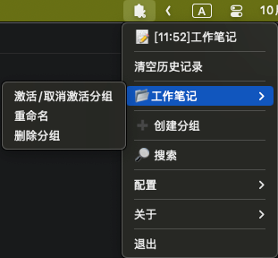

### 配置项详解

右键 → 配置，所有配置项都集中在这里，后面各功能小节会反复用到。三个"设置"类配置（最大历史条数、时间格式、高亮标记）都遵循关键机制——先把内容复制到剪贴板，再点击菜单项：

| 配置项 | 说明 |
|:--|:--|
| 设置最大历史记录条数 | 用**剪贴板数字**设置：复制一个 1-300 的数字后点击菜单项；菜单项实时显示「已有条数/最大条数」（如 `当前: 12/50`）。默认 50，超出上限自动丢弃最早记录 |
| 设置搜索高亮标记 | 搜索命中内容用该标记包裹显示；复制 "前缀 后缀"（空格分隔）后点击设置，默认 【 】 |
| 设置时间格式 | 自定义条目时间显示；复制格式后点击设置，支持 `YYYY YY MM DD HH mm ss` 任意组合（如 `YYYY-MM-DD HH:mm:ss`），默认 `hh:mm` |
| 单独删除项 | 开启后，历史条目右键会出现「删除」按钮 |
| 自动识别颜色 | 开启后，复制颜色值可转换为 Hex / RGB |
| 相同内容只保留最新 | 开启后相同内容只保留最近一条，开启瞬间会清理主历史与分组中的重复记录 |
| 图片重命名 | 开启后可右键图片「重命名」，名称取自最新剪贴板文本 |
| 局域网共享 | 见下文「局域网共享」 |
| 翻译 | 见下文「翻译」 |
| 打开配置文件目录 | 直接打开 `config.json` 所在目录 |
| 退出时保存日志 | 退出程序时把运行日志写入 `clip.log` |

**图：配置菜单全览**

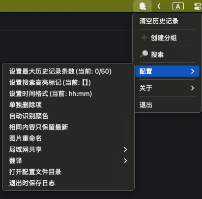

「局域网共享」和「翻译」各自还有展开的三级子菜单：

**图：局域网共享子菜单**

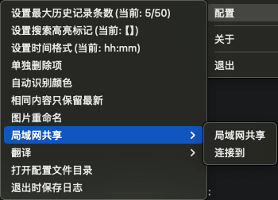

**图：翻译子菜单**

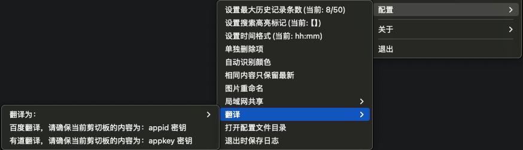

### 条目右键：更多操作

默认情况下，右键菜单中点击历史条目会**直接复制**，没有二级菜单。只有开启了对应的扩展功能（见上文「配置项详解」）后，条目下才会出现二级操作菜单：

- **复制**：点击即复制该条目
- **复制Hex / 复制RGB**：颜色格式转换（开启「自动识别颜色」后，颜色值文本条目显示）
- **重命名**：为图片命名，名称取自最新的剪贴板文本（开启「图片重命名」后，图片条目显示）
- **删除**：删除单条记录（开启「单独删除项」后显示，防止误触）

**图：条目二级菜单**

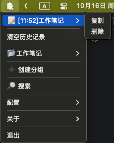

图片重命名示例（名称取自最新一条剪贴板文本）：

```text
1. 复制 "登录界面截图"（作为图片名称）
2. 右键图片条目 → 重命名
3. 显示从 🖼️ [15:04] 图片 [a1b2c3d4] 变为 🖼️ [15:04] 登录界面截图 [a1b2c3d4]
```

**图：图片重命名前后对比**

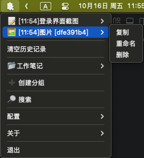

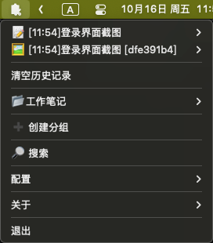

### 清空历史记录

右键菜单中点击「清空历史记录」后不会立即清除，菜单会变为「确认/取消清空历史记录？」，再点一次「确认清空？」才会真正清空，点「取消清空?」放弃操作。

> 清空只作用于主历史记录：分组中已保存的内容不受影响，也不会清空剪贴板中的当前内容。

**图：清空历史记录二次确认**

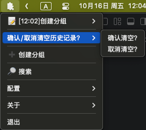

### 分组管理

分组可以把某一类剪贴板内容单独收纳，例如把工作相关的资料集中到一个分组里。

**创建分组**（分组名取自剪贴板）：

```text
1. 复制文本 "工作笔记"（作为分组名）
2. 右键 → ➕ 创建分组
```

> 创建分组的操作过程图示，见[上文「关键机制」](#关键机制最新一条是所有输入的来源)小节。

**激活分组**：右键点击分组名 → 「激活/取消激活分组」。分组激活后（菜单中带 ✓），此后新复制的所有内容都会**同时**自动保存到该分组，相当于给剪贴板内容自动分类归档；激活的瞬间还会把当前最近一条历史同步进分组。激活多个分组时，内容会同时进入所有激活的分组。

**其他操作**（右键点击分组名展开）：

- **重命名**：把新名字复制到剪贴板，再点击「重命名」
- **删除分组**：删除分组及其收纳的全部历史
- 分组条目本身也可以点击复制、右键删除

分组创建并激活后，新复制的内容会自动归档进来。左键菜单直接查看和复制分组内容，右键菜单额外提供分组管理：

**图：左键查看分组内容（点击条目即复制）**

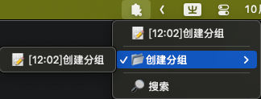

**图：右键管理分组（悬停分组名展开管理子菜单）**

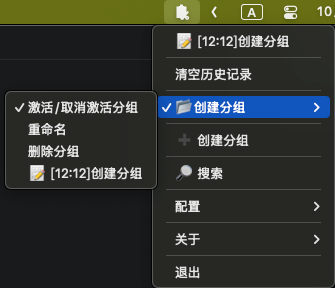

### 搜索历史

用剪贴板内容作为关键词过滤历史记录：

```text
1. 复制关键词，例如 "密码"
2. 左键或右键 → 🔎 搜索
3. 菜单中只显示包含 "密码" 的历史记录，无匹配内容的分组也会自动隐藏
4. 再次点击 🔎 搜索 取消
```

搜索开启后，菜单中的搜索项会显示 ✓ 与当前关键词（如 `🔎 搜索:密码`，超长关键词自动截断），便于确认当前搜索状态。

搜索规则：文本按「包含关键词」匹配；图片按「相同图片」匹配——复制一张图片后搜索，历史中同一张图片的所有记录都会筛出来。

搜索命中时，条目中的关键词会用「【】」包裹标出（长文本会自动把显示窗口对齐到关键词处，保证关键词可见），一眼看出为什么命中。如果与原文中的【】冲突，可自定义标记：复制 `前缀 后缀`（空格分隔，如 `>> <<`）后点击 配置 → 设置搜索高亮标记。

**图：搜索过滤效果**

搜索前（全部历史）：

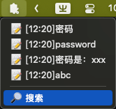

搜索后（仅命中项，关键词高亮）：

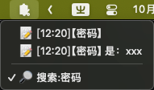

**图：搜索高亮与自定义标记**

自定义标记 `「 」`：

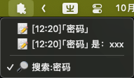

自定义标记 `👉🏻 👈🏻`：

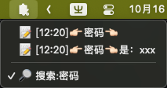

### 颜色识别与转换

写前端时经常在 Hex 和 RGB 之间来回换算，Clip 可以直接在剪贴板里完成：

```text
1. 右键 → 配置 → 勾选「自动识别颜色」
2. 复制 #FF5733
3. 右键点击该条目 → 出现「复制Hex / 复制RGB」
4. 点击「复制RGB」，得到 255,87,51
```

**图：颜色识别与转换**

复制 `#FF5733` 后右键（悬停条目出现转换选项）：

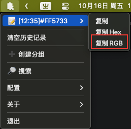

点击「复制RGB」后左键（顶部即转换结果 `255,87,51`）：

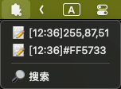

### 翻译（百度 / 有道）

复制文本后自动翻译，结果显示在托盘标题上。

**配置密钥**（首次使用）：

```text
1. 复制翻译器密钥到剪贴板（注意 appid 和密钥之间用空格分隔）
   - 百度翻译: "appid 密钥"
   - 有道翻译: "appkey 密钥"
2. 右键 → 配置 → 翻译 → 点击对应翻译器
   （此时会联网验证一次密钥，验证失败则无法启用）
3. 选择「翻译为：zh / en」设定目标语言
```

未配置密钥的翻译器，菜单名会直接提示格式（如「有道翻译，请确保当前剪切板的内容为：appkey 密钥」）；配置成功后显示为「有道翻译（已配置密钥）」，一眼可知该平台已配置、点击即可启用。

**使用**：之后每次复制文本，托盘标题会实时显示译文；**下次打开菜单时**，译文会自动复制到剪贴板并加入历史记录，可以直接粘贴使用，也可以在历史中回看。

> 翻译子菜单的展开图示见上文「配置项详解」。

**图：未配置与已配置的翻译器显示**

配置前（菜单名直接提示密钥格式）：

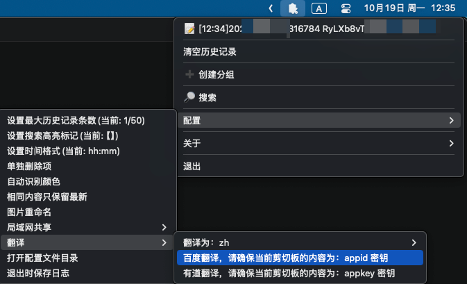

配置后（显示「已配置密钥」，点击即可启用）：

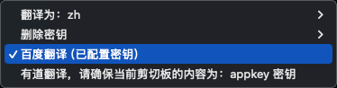

**图：托盘标题显示翻译结果**

复制文本后，托盘标题实时显示译文：

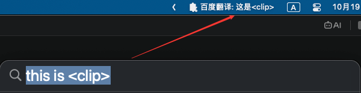

**删除密钥**：右键 → 配置 → 翻译 → 删除密钥 → 点击对应平台。会同时清除系统凭据存储中的密钥和本地的启用状态，删除后可按上面的步骤重新配置。

**图：删除密钥**

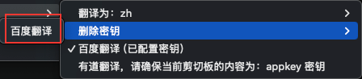

> **密钥安全**：密钥保存在系统凭据存储中（macOS Keychain / Windows 凭据管理器 / Linux Secret Service），配置项本身不落盘。但配置时复制的密钥文本会作为一条历史记录被保存进 `config.json`，建议配置完成后及时删除该条记录（开启「单独删除项」后可右键删除）。如果系统凭据存储不可用，翻译器将无法在重启后自动恢复启用状态。

### 局域网共享

**场景**：两台电脑（同一局域网）互相实时共享剪贴板。

**电脑 A（服务端）**：

```text
1. 右键 → 配置 → 局域网共享 → 点击「局域网共享」
2. 服务地址（如 192.168.1.100:54321）自动复制到剪贴板
```

**电脑 B（客户端）**：

```text
1. 粘贴并复制地址 192.168.1.100:54321
2. 右键 → 配置 → 局域网共享 → 「连接到」
3. 连接成功，A 复制的内容会实时出现在 B 的历史记录中（带 [R] 标记）
```

连接列表会显示在「局域网共享」子菜单中，点击某条地址即可断开对应连接。

**图：启用局域网共享**

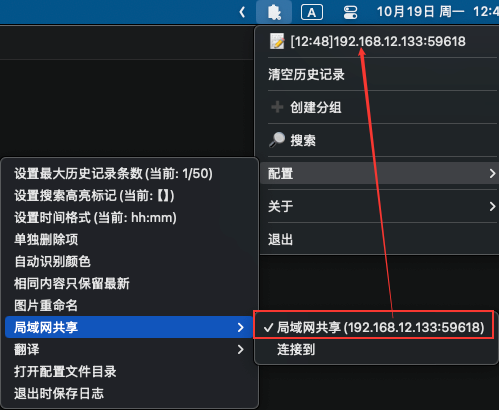

**图：连接到共享**

点击「连接到」完成连接：

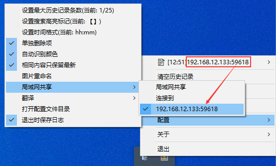

连接成功后，共享的内容会实时出现在接收端的历史记录中（带 [R] 标记）：

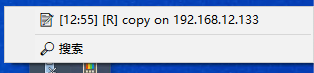

### 数据与日志位置

配置文件、历史记录和日志都保存在系统配置目录的 `Clip` 文件夹下：

- **macOS**：`~/Library/Application Support/Clip/`
- **Linux**：`~/.config/Clip/`
- **Windows**：`%AppData%/Clip/`

- `config.json`：配置与历史记录（含分组）
- `clip.log`：运行日志（开启「退出时保存日志」后，退出时生成）

> 翻译器密钥的存储方式与注意事项，见上文「密钥安全」。


## 总结

Clip 把剪贴板从"只能存一条"升级成一个带历史、分组、搜索的多条目管理器：

- 📋 文本/图片历史自动记录，左键一键回贴
- 📂 分组归档，激活后自动分类
- 🔍 剪贴板即搜索框，命中高亮，图片按图搜图
- 🌍 复制即翻译，密钥存系统钥匙串更安全
- 🌐 局域网共享，多台电脑剪贴板互通

源码与最新版本：[github.com/DoYoungDo/clip](https://github.com/DoYoungDo/clip)，觉得好用欢迎 Star，遇到问题欢迎提 Issue。
